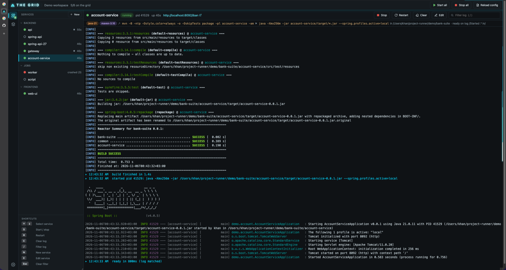
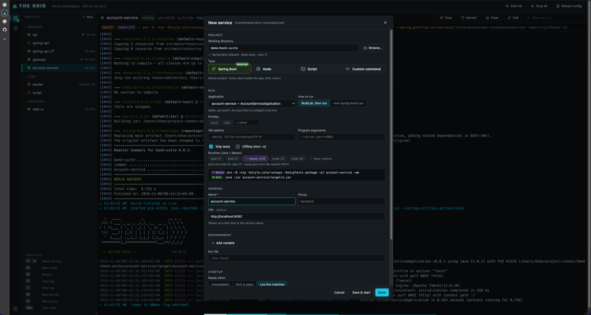
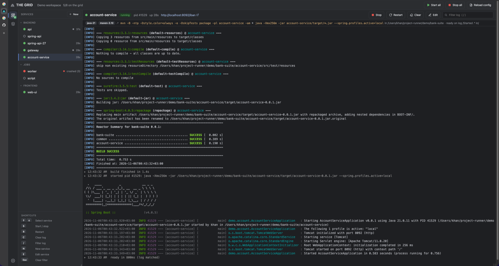

<p align="center">
  
</p>

<h1 align="center">The Grid</h1>

<p align="center"><em>"The Grid. A digital frontier."</em> Your services are the programs; you run them from here.</p>

Run, watch and restart all the local services of a workspace from one browser tab —
like IntelliJ's **Services** tool window, without the IDE.

Built for the AI-agent era: the code is written by Claude/Codex in a terminal, you just
need 3–4 APIs, UIs and scripts running side by side with their logs one click away.



<table>
  <tr>
    <td width="50%"></td>
    <td width="50%"></td>
  </tr>
  <tr>
    <td align="center"><sub>New service — Spring Boot detected from the folder</sub></td>
    <td align="center"><sub>Basic theme (Settings)</sub></td>
  </tr>
</table>

- Plain Node.js: one self-contained bundle (UI embedded), no admin rights
- Groups, start/stop/restart per service, group or all
- Spring Boot (Maven), Node and script services are detected from the folder; each start
  builds when needed, then runs — no command to write
- Add / edit / delete services and runtimes from the UI (writes `grid.yaml`, keeps comments)
- Several JDKs / Node versions side by side (`runtimes`), one per service
- **Changes** view: read-only git diff per service to review what an AI agent wrote
- Live colored logs (xterm.js), filter, also written to files under `~/.grid/logs`
- CPU and memory of each running service (its whole process tree)
- **Terminals** in the same window (``Ctrl+` ``): real shells opened in the selected service's folder
- **Database** panel: a small Oracle / PostgreSQL SQL client you can share with your AI agent over MCP
- `depends_on` + readiness (`port` or log regex) so things start in order
- Restart policies (`on-failure`, `always`)
- Clean process-tree kill, no orphan `java`/`node` keeping your port busy
- Turkish Windows friendly: `encoding: cp1254` / auto-detect
- CLI and MCP server for scripts and AI agents
- Listens on 127.0.0.1 only, with CSRF and DNS-rebinding protection
- `grid update` fetches new versions from the distribution repo

## Quick start

Needs Node.js 17 or newer.

```sh
cd node
npm install
npm run release                  # embeds web/dist, bundles into node/release/
cd release
node grid.bundle.cjs serve       # opens http://127.0.0.1:18900
```

`cp grid.example.yaml grid.yaml` gives a starting config, or start empty and add services in the UI.
Config lookup: `--config=<file>`, else `./grid.yaml`, else the last workspace you opened (remembered in
`~/.grid`, override the folder with `$GRID_HOME`). Switch workspaces from the name next to the logo.
The default port is `18900` (`-p <port>` or `$GRID_PORT`).

The UI is prebuilt in `web/dist`; rebuild it with `cd web && npm install && npm run build` when you change it.
The database drivers (`pg`, `oracledb`) are bundled as separate files in `release/drivers/` and loaded on first
use. The only native part is `node-pty` (terminals), shipped in `release/node_modules`.

Keyboard (Services): `j`/`k` move, `/` filter the log, `s` start or stop, `r` restart, `c` clear, `n` new,
`e` edit, ``Ctrl+` `` terminals.

## Service types: build, then run

Like an IDE run configuration, a service can say *what* it is instead of giving a command.
The commands are derived on every start, so they follow changes in `pom.xml`:

| `type` | build step (every start) | run |
|---|---|---|
| `spring-boot` | `mvn -B -Dmaven.test.skip=true package [-pl <module> -am]` (uses `mvnw` if present), skipped when nothing changed | `java <jvm_args> -jar <module>/target/*.jar --spring.profiles.active=…` |
| `spring-boot` + `mode: run` | — | `mvn spring-boot:run` |
| `node` | `npm/yarn/pnpm install`, only when `package.json` or the lock file changed | `npm run <script>` |
| `script` | — | the `.bat` / `.cmd` / `.ps1` / `.sh` / `.py` file |
| `jar` | — | `java <jvm_args> -jar <file> <args>` (an already built jar; `file` may use `*`, newest match wins) |
| `custom` (default) | — | `command` as written |

A Spring Boot build is **skipped when nothing changed**. Tick **Always rebuild** (`always_build: true`) to build on
every start. By default tests are neither run nor compiled (`skip_tests`).

While the build runs the service shows **building**; a failed build stops there, and Stop/Restart during a build
cancel it. Right-click → **Run without build** starts the last build output.

In the form, pick the working directory (type it or **Browse…**) and the project is detected: Spring Boot apps in
single- or multi-module Maven builds, the main class, `java.version` (matching Java runtime preselected),
`server.port` (URL), profile files, or `package.json` scripts, lock file and `engines.node`.
The generated build and run commands are previewed as you edit.

## For AI agents: `grid mcp`

`grid mcp` is an MCP server (stdio), so an agent can run the edit → restart → read logs loop without you
copy-pasting:

| tool | what it does |
|---|---|
| `status` | services and their state |
| `logs` | last N log lines of a service (colors removed). Filters save tokens: `level` (error / warn), `grep` (regex), `since_restart`, `context` |
| `describe` | one service in full: folder, build and run command, URL, readiness, dependencies, runtimes |
| `restart` | restart / start / stop, waits until it is running or failed, returns the last log lines |
| `wait` | keep waiting for a service that `restart` reported as still building / starting |
| `reload` | re-read `grid.yaml` and the saved database connections after a manual edit |
| `service_add` / `service_edit` / `service_remove` | manage services in `grid.yaml` |
| `runtimes`, `runtime_add` / `runtime_edit` / `runtime_remove` | list and manage runtimes |
| `db_list`, `db_tables`, `db_describe`, `db_query`, `db_execute` | shared database connections (see below) |

Slow machines (a VDI building with Maven) are handled so the agent never mistakes a long build for a failure:
`restart` waits at most 40 s by default (`grid mcp --wait 60` to change it), then answers "STILL BUILDING ... not a
failure, call `wait`".

The Grid itself must be running. Register it in the agent's MCP config, for example:

```json
{ "mcp": { "grid": { "type": "local", "command": ["node", "/path/to/grid.bundle.cjs", "mcp"], "enabled": true,
                      "environment": { "GRID_PORT": "18900" } } } }
```

## Database panel

A small SQL client for **Oracle** (19c+, Thin mode, no client to install) and **PostgreSQL** (10+). Open the
**Database** panel (cylinder icon), add a connection, test it, then browse schemas, tables and columns on the left
and write SQL on the right:

- **Run:** `Ctrl+Enter` runs the selection, or everything; `Ctrl+Shift+Enter` only the statement under the cursor.
  `Stop` cancels a running statement.
- **Several statements** (separated by `;`) run one after the other, each result in its own tab. Oracle: a PL/SQL
  block ends with a line holding only `/`.
- **Completion:** tables, views, schemas and columns from the database as you type.
- **Results:** a scrolling grid you can copy or download as CSV, paged with Prev / Next.
- **Commit and rollback:** by default changes wait for **Commit** / **Rollback**; the connection can commit every
  statement automatically instead.
- **Where connections live:** `~/.grid/connections.json`, per user, not in `grid.yaml`. Passwords are stored as
  plain text there.

### Sharing a database with AI (MCP)

Each connection has an **AI access (MCP)** setting: *Read-only* (default), *Read and write*, or *Not shared*.
Read-only is enforced by the Grid: the statement must be a single `SELECT` / `WITH` without `FOR UPDATE`, it runs in
a read-only transaction that is always rolled back, and anything else is refused. A separate read-only database user
is still the strongest protection. Everything the AI reads goes to your model provider; there is no masking.

## Log files

Every line a service logs is appended (colours removed, with time and stream) to
`~/.grid/logs/<workspace>-<hash>/<service>.log`. Turn it off with **Save logs to files** in Settings → Logs.
Each service takes at most **10 MB** (`<service>.log` rotates to `<service>.log.1` at 5 MB). Clearing the log in the
UI does not touch the files.

## Adding and editing services in the UI

**New** (sidebar, or `N`), the **+** on a group header, **✎** on a row, right-click → **Edit**, or **Edit** in the
toolbar (`E`) open the form. Saving writes `grid.yaml` directly:

- the file is edited as a YAML tree, so comments and keys the form doesn't know are kept
- the result is validated before it replaces the file; the previous version is kept as `grid.yaml.bak`
- editing a running service applies on its next start (**Save & restart** does both)
- deleting a running service stops it first; a service others depend on can't be deleted

## CLI

```
grid [serve] [--config=file] [-p 18900] [--no-browser]
grid status
grid start|stop|restart <service|all>
grid logs <service> [n]
grid mcp [-p 18900] [--wait 40]    # MCP server for AI agents
grid update [--check] [--force]
grid version
```

Run it as `node grid.bundle.cjs <command>`. `GRID_PORT` overrides the port.

## Config

See [`grid.example.yaml`](grid.example.yaml) for every option.

| key | meaning |
|---|---|
| `type` | `spring-boot`, `node`, `script`, `jar` or `custom` (default); see *Service types* |
| `command` | command line for `custom` services, run through `shell` |
| `shell` | Windows: `cmd` (default), `powershell`, `pwsh` or a bash path; Unix: `/bin/sh` |
| `cwd` | working directory, relative to the config file |
| `group` | sidebar group |
| `env`, `env_file` | environment; `${VAR}` references are expanded |
| `depends_on` | services that must be ready first |
| `ready` | `{ port: 8080 }` or `{ log: "Started .* in" }`, optional `timeout` |
| `restart`, `max_restarts` | `no` / `on-failure` / `always` |
| `autostart` | start when the Grid starts |
| `changes`, `changes_ignore` | keep a project, or paths in it, out of the **Changes** view |
| `encoding` | `auto` (default), `utf-8`, `cp1254` |
| `url` | link shown in the UI |
| `stop_timeout` | grace period before kill (Unix), default `10s` |
| `runtime` | one name or a list from `runtimes` (e.g. `[java-11, maven-3.9]`) |
| `color` | force colored output (`FORCE_COLOR`, Spring ANSI), default `true` |

## Runtimes (several JDKs / Node versions side by side)

```yaml
runtimes:
  java-11:   { home: "C:/Program Files/Java/jdk-11.0.24" }
  java-17:   { home: "C:/Program Files/Java/jdk-17.0.21.0.2" }
  maven-3.9: { home: "C:/tools/maven3" }
  node-20:   { home: "C:/tools/node-v20.18.0-win-x64" }

services:
  legacy-api: { command: "java -jar legacy.jar", runtime: java-11 }
  account-api: { command: "mvn spring-boot:run", runtime: [java-17, maven-3.9] }
  web-ui: { command: "npm run dev", runtime: node-20 }
```

Without `runtime:` a service uses whatever is on the system PATH. With it, the runtime's bin dir is put first on PATH.

| type | what it does |
|---|---|
| `java` | sets `JAVA_HOME` and puts `bin` first on PATH, so `java` and `mvn` use this JDK |
| `node` | puts the Node folder first on PATH (`node`, `npm`, `npx`) |
| `script` | any tool folder (Maven, Gradle, Python…): its `bin` (or the folder itself) goes first on PATH |

The type is inferred from the name (`java-*`, `jdk*`, `jre*` → java, `node*` → node, anything else → script) or set
with `type:`. A service may use at most one java and one node runtime but any number of script runtimes. Runtimes can
also be managed in the UI (the **Runtimes** list at the bottom of the sidebar), which shows the real
`java -version` / `node --version` while you type.

## Development

```sh
cd web && npm install && npm run build    # rebuild web/dist (commit it)
cd node && npm install
npm test                                  # Node tests
npm run build                             # bundle into node/dist/
npm run release                           # same, and copy to node/release/
npm run dist -- <dist repo folder>        # release + files and manifest.next.json for the distribution repo
```
