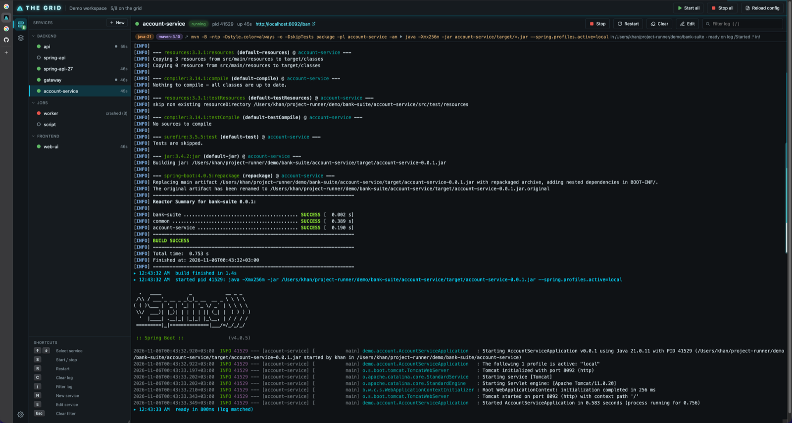
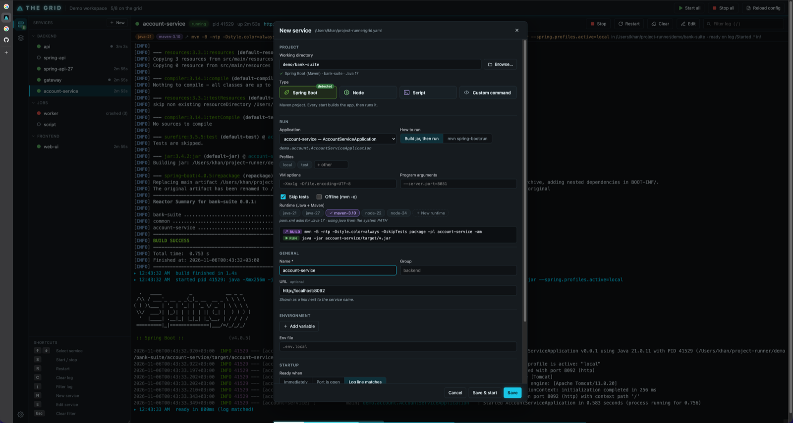
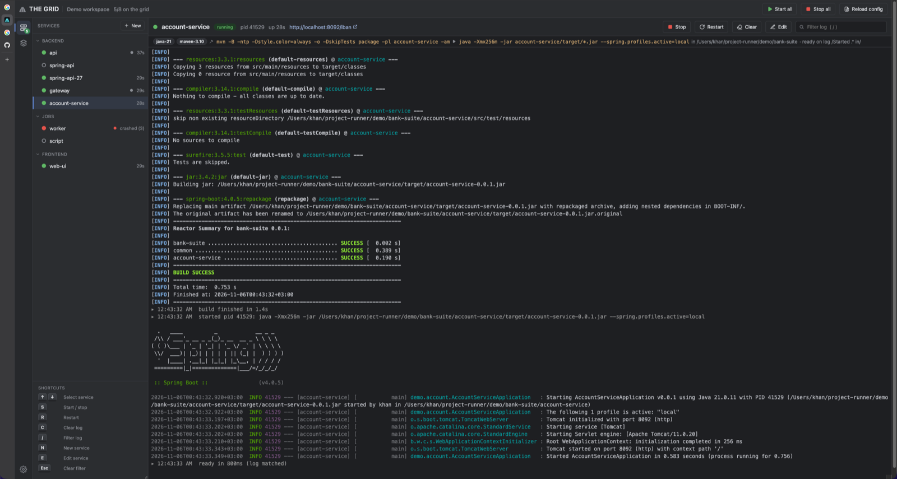

# The Grid

> *"The Grid. A digital frontier."* Your services are the programs; you run them from here.

Run, watch and restart all the local services of a workspace from one browser tab —
like IntelliJ's **Services** tool window, without the IDE.

Built for the AI-agent era: the code is written by Claude/Codex in a terminal, you just
need 3–4 APIs, UIs and scripts running side by side with their logs one click away.



<table>
  <tr>
    <td width="50%"></td>
    <td width="50%"></td>
  </tr>
  <tr>
    <td align="center"><sub>New service — Spring Boot detected from the folder</sub></td>
    <td align="center"><sub>Basic theme (Settings)</sub></td>
  </tr>
</table>

- One self-contained binary (UI embedded), no install, no admin rights
- Groups, start/stop/restart per service, group or all
- Spring Boot (Maven), Node and script services are detected from the folder; every start
  builds, then runs — no command to write
- Add / edit / delete services and runtimes from the UI (writes `grid.yaml`, keeps comments)
- Several JDKs / Node versions side by side (`runtimes`), one per service
- Live colored logs (xterm.js), filter, 10k lines per service
- `depends_on` + readiness (`port` or log regex) so things start in order
- Restart policies (`on-failure`, `always`)
- Clean process-tree kill: Windows Job Objects / Unix process groups — no orphan
  `java`/`node` keeping your port busy
- Turkish Windows friendly: `encoding: cp1254` / auto-detect
- CLI for scripts and AI agents: `grid logs api -n 100`, `restart api`
- Listens on 127.0.0.1 only, with CSRF and DNS-rebinding protection

## Quick start

```sh
cp grid.example.yaml grid.yaml   # or start empty and add services in the UI
go build -o grid .               # Windows: go build -o grid.exe .
./grid                           # opens http://localhost:7070
```

The UI is prebuilt in `web/dist` and Go deps are vendored, so building only needs Go —
no npm or internet access.

## Service types: build, then run

Like an IDE run configuration, a service can say *what* it is instead of giving a command.
The commands are derived on every start, so they follow changes in `pom.xml`:

| `type` | build step (every start) | run |
|---|---|---|
| `spring-boot` | `mvn -B -DskipTests package [-pl <module> -am]` (uses `mvnw` if present) | `java <jvm_args> -jar <module>/target/*.jar --spring.profiles.active=…` |
| `spring-boot` + `mode: run` | — | `mvn spring-boot:run` |
| `node` | `npm/yarn/pnpm install`, only when `package.json` or the lock file changed | `npm run <script>` |
| `script` | — | the `.bat` / `.cmd` / `.ps1` / `.sh` / `.py` file |
| `jar` | — | `java <jvm_args> -jar <file> <args>` (an already built jar; `file` may use `*`, newest match wins) |
| `custom` (default) | — | `command` as written |

While the build runs the service shows **building**; a failed build stops there (the app is
not started), and Stop/Restart during a build cancel it. Right-click → **Run without build**
starts the last build output. Crash restarts reuse the last build.

In the form, pick the working directory (type it or **Browse…**) and the project is detected:
Spring Boot apps in single- or multi-module Maven builds (by `@SpringBootApplication`), the
main class, `java.version` (matching Java runtime preselected), `server.port` (URL), profile
files (`application-*.yml`), or `package.json` scripts, lock file and `engines.node`.
The generated build and run commands are previewed as you edit.

## Adding and editing services in the UI

**New** (sidebar, or `N`), the **+** on a group header, **✎** on a row, right-click → **Edit**,
or **Edit** in the toolbar (`E`) open the form. Saving writes `grid.yaml` directly:

- the file is edited as a YAML tree, so comments and keys the form doesn't know are kept
- the result is validated before it replaces the file; an invalid change is rejected and
  the file is left untouched; the previous version is kept as `grid.yaml.bak`
- editing a running service applies on its next start (**Save & restart** does both);
  renaming requires the service to be stopped, and `depends_on` references follow the rename
- deleting a running service stops it first; a service others depend on can't be deleted

Deep links: `http://localhost:7070/#new`, `#new=<group>`, `#new-dir=<folder>`, `#edit=<service>`,
`#runtimes`, `#runtime=<name>`.

## CLI

```
grid [serve] [-c grid.yaml] [-p 7070] [--no-browser]
grid status [--json]
grid start|stop|restart|clear <service|group|all>
grid logs <service> [-n 200] [-f] [--raw]
grid reload
grid runtimes              # check every runtime path and print its real version
```

For the fans: `grid programs` = status, `grid rez <x>` = start, `grid derezz <x>` = stop,
`grid eol` ("end of line") stops everything. `GRID_PORT` overrides the port.

## Config

See [`grid.example.yaml`](grid.example.yaml) for every option.

| key | meaning |
|---|---|
| `type` | `spring-boot`, `node`, `script`, `jar` or `custom` (default); see *Service types* |
| `spring` / `node` / `script` / `jar` | options of the typed service (module, profiles, jvm_args, args, mode, skip_tests, offline / script, args, install, package_manager / file, args / file, jvm_args, args) |
| `command` | command line for `custom` services, run through `shell` |
| `shell` | Windows: `cmd` (default), `powershell`, `pwsh` or a bash path; Unix: `/bin/sh` |
| `cwd` | working directory, relative to the config file |
| `group` | sidebar group |
| `env`, `env_file` | environment; `${VAR}` references are expanded |
| `depends_on` | services that must be ready first |
| `ready` | `{ port: 8080 }` or `{ log: "Started .* in" }`, optional `timeout` |
| `restart`, `max_restarts` | `no` / `on-failure` / `always` |
| `autostart` | start when the runner starts |
| `encoding` | `auto` (default), `utf-8`, `cp1254` |
| `url` | link shown in the UI |
| `stop_timeout` | grace period before kill (Unix), default `10s` |
| `runtime` | one name or a list from `runtimes` (e.g. `[java-11, maven-3.9]`) |
| `color` | force colored output (`FORCE_COLOR`, Spring ANSI), default `true` |

## Runtimes (several JDKs / Node versions side by side)

```yaml
runtimes:
  java-11:   { home: "C:/Program Files/Java/jdk-11.0.24" }
  java-17:   { home: "C:/Program Files/Java/jdk-17.0.21.0.2" }
  maven-3.9: { home: "C:/Program Files/JetBrains/IntelliJ IDEA 2025.3.3/plugins/maven/lib/maven3" }
  node-20:   { home: "C:/tools/node-v20.18.0-win-x64" }

services:
  legacy-api: { command: "java -jar legacy.jar", runtime: java-11 }
  account-api: { command: "mvn spring-boot:run", runtime: [java-17, maven-3.9] }
  web-ui: { command: "npm run dev", runtime: node-20 }
```

Without `runtime:` a service uses whatever is on the system PATH. With it, the runtime's
bin dir is put first on PATH. There are three types:

| type | what it does |
|---|---|
| `java` | sets `JAVA_HOME` and puts `bin` first on PATH, so `java` and `mvn` use this JDK |
| `node` | puts the Node folder first on PATH (`node`, `npm`, `npx`); the plain Windows zip works |
| `script` | any tool folder (Maven, Gradle, Python, own scripts): its `bin` (or the folder itself) goes first on PATH |

The type is inferred from the name (`java-*`, `jdk*`, `jre*` → java, `node*` → node,
anything else → script) or set with `type:`. A service may use at most one java and one node runtime
but any number of script runtimes. A runtime may carry its own `env` (e.g. `MAVEN_OPTS`).
`grid runtimes` checks every path and prints the real version; a missing path
makes the service fail with a clear message.

Runtimes can also be managed in the UI: the **Runtimes** list at the bottom of the
sidebar (or **+ New runtime** in the service form) opens a form that checks the folder
while you type and shows the real `java -version` / `node --version`. A runtime that a
service still uses cannot be deleted; renaming one updates the services that use it.

## Development

```sh
make dev     # Go API on :7070 + Vite with hot reload on :5173
make web     # rebuild web/dist (commit it)
make vendor  # after changing Go deps (commit vendor/)
make windows # cross-compile bin/grid.exe
```
